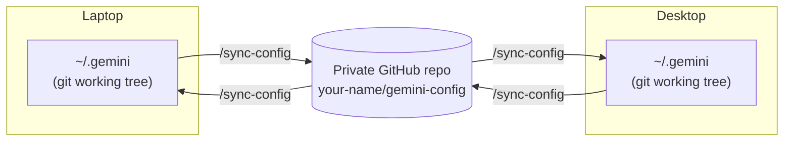
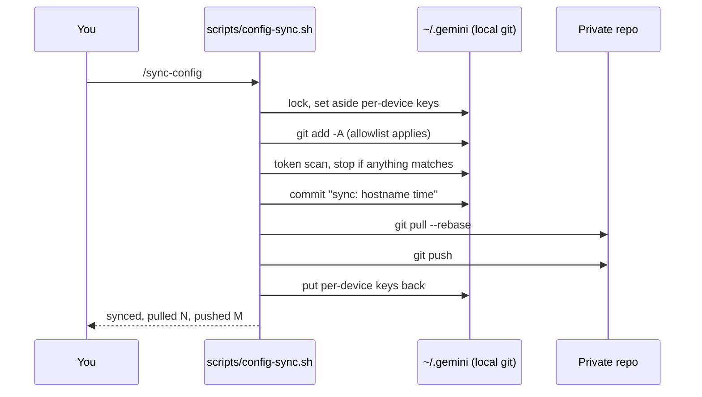
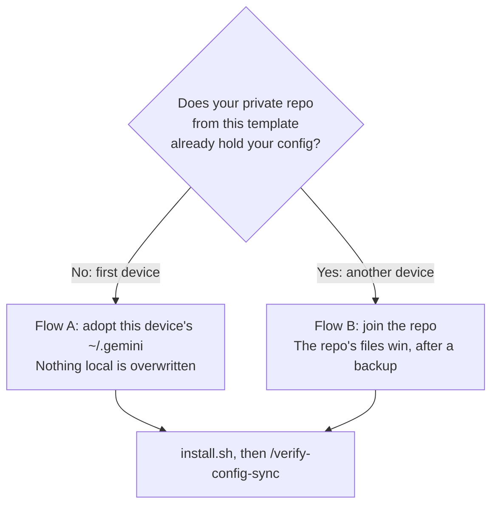
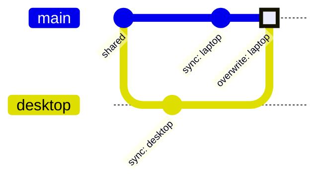
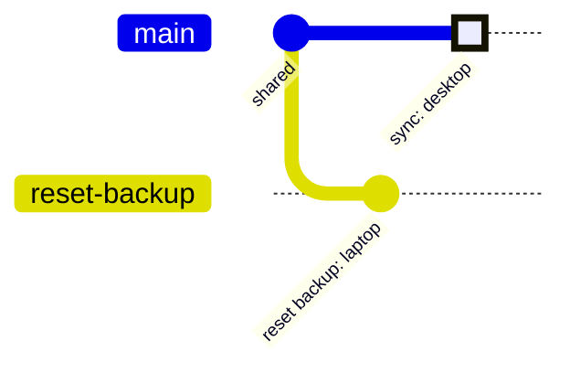

# AntigravitySync

Keep your Gemini CLI and Antigravity CLI setup (`~/.gemini`) the same on every device, through a private git repo you own.

**Set it up with your agent.** Paste this into Antigravity, Gemini CLI, or Claude Code on your first device:

```text
Set up AntigravitySync for me: read https://raw.githubusercontent.com/PoyoPoak/AntigravitySync/main/SETUP.md and follow it.
```

**Or start by hand:** click **Use this template → Create a new repository**, and set it to **Private**. Do not fork it, and never make your copy public: it holds your agent config. Then follow [SETUP.md](SETUP.md).

## Why this exists

I work across a laptop and a desktop and often switch between them in the same day. I keep my own Gemini CLI and Antigravity setup in a private repo that syncs `~/.gemini` between them, and this template is a generalized copy of it with everything personal stripped out, so you can build the same thing for your devices. It is the companion to [ClaudeCodeSync](https://github.com/PoyoPoak/ClaudeCodeSync), which does the same for Claude Code.

Remote access is handy: Claude Code's Remote Control, for example, lets me drive a session on my desktop from my laptop. But it means leaving the main PC on, and I don't always want to. I also want to work on the code myself — run it, test it, click through it — beyond what an agent can test, verify, or use for me. So instead of remoting into one machine, every device carries the same agent setup locally, and I pick up wherever I am.

## How it works

`~/.gemini` itself becomes a git repo. An allowlist `.gitignore` decides what is shared; everything else stays on the device.



- **Allowlist:** `.gitignore` starts with `/*` and opts files back in. Credentials, history, caches, and anything new a CLI writes stay local by default.
- **Token scan:** every sync checks staged files against `scripts/token-patterns.txt` and stops before committing if anything looks like a key.
- **Per-device keys:** `model` in both settings files and `trustedWorkspaces` in `antigravity-cli/settings.json` stay per device. Each device keeps its own values, and the repo does not store them.
- **Manual sync:** nothing runs in the background. You sync when you switch devices.

One sync, step by step:



## What syncs

| Item | Location | How |
| --- | --- | --- |
| Gemini CLI settings and MCP servers | `settings.json` | Tracked. Secrets are `$VAR` references, see below |
| Gemini CLI rules, commands, skills, agents, policies | `GEMINI.md`, `commands/`, `skills/`, `agents/`, `policies/` | Tracked once created |
| Antigravity global rules | `config/AGENTS.md` | Tracked |
| Antigravity hooks | `config/hooks.json`, `config/hooks/` | Tracked |
| Antigravity skill sources and skills | `config/skills.json`, `config/skills/` | Tracked |
| Antigravity plugin list | `config/import_manifest.json` | Declared, then installed per device |
| Antigravity settings | `antigravity-cli/settings.json` | Tracked |
| CLIs your config needs | `scripts/tools.txt` | Checked by `install.sh` and `/verify-config-sync` |
| Sync tools | `scripts/`, `config/skills/sync-config/`, `config/skills/verify-config-sync/` | Tracked. `skills/` links to the two skills so Gemini CLI finds them too |

To sync something else, add a `!/path` line to `.gitignore`. To check for another CLI on each device, add a line to `scripts/tools.txt`.

## What stays on each device

- **Secrets:** `.env`, `oauth_creds.json`, `google_accounts.json`, `config/mcp_config.json`, and the Antigravity tokens in `antigravity-cli/`
- **Model and trust:** `model` in both settings files and `trustedWorkspaces` in `antigravity-cli/settings.json`. The repo never stores them: a joining device keeps its own (SETUP.md carries them over), and a fresh one starts from the CLI's defaults. To keep more keys per device, edit `KEYS` in `scripts/config-sync.sh`.
- **Plugin files:** `config/plugins/`, which is large and reinstallable
- **Local data:** `history/`, `tmp/`, `projects.json`, `state.json`, `trustedFolders.json`, `installation_id`, and everything else in `antigravity-cli/`

### Secrets

Never put tokens in `settings.json`. Put them in `~/.gemini/.env` (`chmod 600`) and refer to them as `${NAME}` in `settings.json`. Gemini CLI expands the reference when it loads settings. For example, an MCP server header can read `"Authorization": "Bearer ${MY_API_KEY}"`.

- Gemini CLI loads only the first `.env` it finds, walking up from the working directory, so a project `.env` hides `~/.gemini/.env`. In an untrusted folder it loads only auth variables. If either matters, export the variable from your shell profile instead.
- Antigravity's `config/mcp_config.json` does not sync. Add its servers on each device with `agy mcp add`.

## Set up

[SETUP.md](SETUP.md) has the full steps. It is written for your agent to follow, and reads fine by hand.



To add another device later, paste this into its agent:

```text
Join this device to my AntigravitySync repo <your repo URL>: read https://raw.githubusercontent.com/PoyoPoak/AntigravitySync/main/SETUP.md and follow flow B.
```

## Sync

Each sync commits local changes, pulls with rebase, then pushes. `scripts/config-sync.sh` does the work.

| Command | Effect |
| --- | --- |
| `/sync-config` | Sync now |
| `/sync-config overwrite` | Make the remote match this device. Other devices' changes are replaced, not merged |
| `/sync-config reset` | Make this device match the remote. Pending edits here are saved on a local backup branch, never pushed |
| `/sync-config help` | List these commands |

In Antigravity these are slash commands. In Gemini CLI, ask for them by name ("sync my config", "verify config sync") and the skill runs. Without either CLI, run `bash ~/.gemini/scripts/config-sync.sh` with `--now`, `--overwrite`, `--reset`, or `--help`.

Sync is manual only, so **sync before you switch devices**. Neither CLI has a session-end hook plus a tested way to tell a window you opened from a headless or nested session, so an automatic sync could run at the wrong time.

A pull that changes `config/import_manifest.json` lists the plugins this device is missing.

How `overwrite` and `reset` look in history, seen from the laptop:



- **Overwrite** merges the remote with `-s ours`: the result keeps the laptop's files and records the desktop's commit as merged, so the push is a normal fast-forward and the replaced work stays in history.



- **Reset** commits the laptop's pending edits to a local `reset-backup/<time>` branch, which is never pushed, then moves the laptop's `main` to the remote's latest commit (highlighted).

## Verify

Run `/verify-config-sync`. It runs only when called, and it changes nothing. `/verify-config-sync test` also runs the test suite.

Without either CLI:

```bash
bash ~/.gemini/scripts/verify-config-sync.sh          # health check
bash ~/.gemini/scripts/test-config-sync.sh            # offline tests with temporary repos
```

It checks that the repo is private, in step with the remote, free of tracked secrets and tokens, that the JSON config parses, that `$VAR` secrets resolve, that plugins and the tools in `scripts/tools.txt` are present, and that no config file points into another user's home directory.

## Update from this template

Repos made from a template share no history with it, so pull fixes by path instead of merging:

```bash
cd ~/.gemini
git remote add upstream https://github.com/PoyoPoak/AntigravitySync.git   # once
git fetch upstream
git checkout upstream/main -- scripts/config-sync.sh scripts/install.sh scripts/verify-config-sync.sh \
  scripts/test-config-sync.sh scripts/token-patterns.txt config/skills/sync-config config/skills/verify-config-sync
git diff --cached        # review, and keep your own changes (KEYS, token patterns) where they differ
bash scripts/test-config-sync.sh && bash scripts/config-sync.sh --now
```

`scripts/tools.txt` and `.gitignore` are yours to customize, so they are left out; compare them with `git diff upstream/main -- scripts/tools.txt .gitignore` if you want the template's changes.

## Platform support

- **Tested:** Linux and WSL2.
- **macOS:** untested. The scripts use `flock`, `timeout`, and GNU `date`, which macOS lacks by default. `install.sh` reports what is missing.
- **Windows:** use WSL.

## Troubleshooting

- **Overwrite:** to recover a replaced change, find the `overwrite:` commit with `git log` and restore files from its second parent: `git checkout <commit>^2 -- <path>`.
- **Reset:** files outside the allowlist stay as they are. To recover a file, run `git checkout reset-backup/<time> -- <path>`. To delete an old backup, run `git branch -D reset-backup/<time>`.
- **After an overwrite:** other devices' unsynced edits come back on their next sync. Run `/sync-config reset` on those devices first to drop them.
- **Conflict warning:** two devices changed the same line. Sync kept your local commit and did not push. `/sync-config overwrite` resolves it in favor of this device, and `/sync-config reset` in favor of the remote. To merge by hand, run `git pull --rebase` in `~/.gemini`, resolve the conflict, then run `git rebase --continue` and `git push`.
- **Possible token warning:** sync stopped before committing. Move the secret into `~/.gemini/.env` and refer to it as `${NAME}`. If a token already reached GitHub, revoke it: removing it from git is not enough.
- **Pull or push failed:** check network and SSH with `ssh -T git@github.com`. A key with a passphrase needs `ssh-agent`, because the sync cannot prompt. Run `/sync-config` to retry.
- **Commit failed:** set `git config --global user.name` and `user.email` on this device.
- **A path points into another home:** a config file has an absolute path like `/home/alex/...` that does not exist on this device. Use the same username on every device, or change the path.
- **Mode-only changes (`100755 => 100644`) on WSL:** a Windows tool writing over `\\wsl$` dropped the executable bit. `scripts/install.sh` restores the bits and sets `core.fileMode false`. That setting lives in `.git/config`, which does not sync, so run it once on each WSL device.

## License

[MIT](LICENSE)
