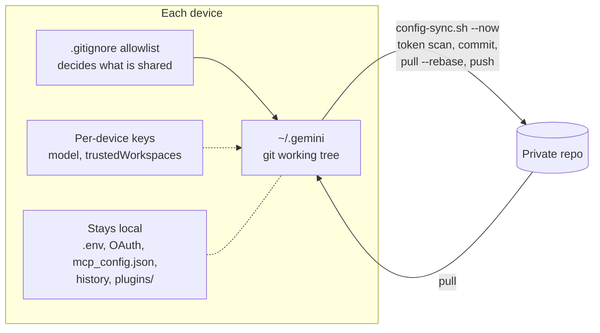
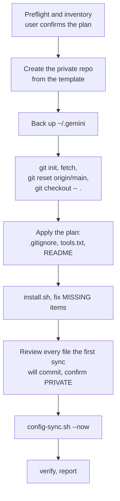
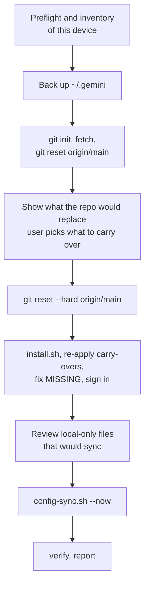

# AntigravitySync setup playbook

This file is for the AI agent (Antigravity, Gemini CLI, Claude Code, or another) that a user has asked to set up AntigravitySync. A person can follow it by hand too.

## Your goal

Make the user's `~/.gemini` a git working tree linked to a **private** repo made from this template, so their Gemini CLI and Antigravity setup syncs between devices with `/sync-config`. Adapt the template to the user's existing setup, not the other way around.



Read [README.md](README.md) for what syncs, the sync commands, and troubleshooting. This file covers setup only.

## Ground rules

- **Private only.** The repo holds the user's agent config. Create it with `--private`, and confirm `PRIVATE` before the first push. Never fork the template: forks of public repos are public.
- **Never expose secrets.** Do not print, paste, or commit token values. When you find one, name the file and key only, and move the value into `~/.gemini/.env` as a `${NAME}` reference.
- **Back up first.** Copy `~/.gemini` before changing anything in it. The backup is local and still holds `.env` and any secrets you moved out, so tell the user to delete it once they are happy.
- **Use absolute paths.** Your shell may start in a project folder, and `cd` may not carry over between commands. The commands below use `git -C ~/.gemini` and `bash ~/.gemini/scripts/...` for that reason; keep it that way, so you never stage, reset, or check the wrong repo.
- **Ask before outward-facing or destructive steps:** creating the repo, the first push, `git reset --hard`, deleting files.
- **The user's setup wins.** Keep their tools, hooks, statusline, skills, plugins, and MCP servers working. Change the allowlist, `scripts/tools.txt`, and docs to fit them.
- **Interactive commands go to the user.** `agy plugin import`, sign-ins, and SSH key setup need a person. Give them the exact command.
- **Tested on Linux and WSL2.** macOS is untested; native Windows is not supported (use WSL).

## 1. Preflight

Ask the user which case applies:

- **Flow A, first device:** they have no repo yet, or the repo from this template still holds only the template files.
- **Flow B, joining device:** their repo already holds config from another device.

Then check the basics:

```bash
for t in git python3 flock timeout gh agy gemini; do command -v "$t" >/dev/null || echo "missing: $t"; done
git config --global user.name; git config --global user.email   # sync commits need both
gh auth status                    # optional, lets verify confirm the repo is private
ssh -T git@github.com             # expect "successfully authenticated" (exit code 1 is normal)
ls -la ~/.gemini 2>/dev/null; git -C ~/.gemini rev-parse --git-dir 2>/dev/null
```

- Missing `user.name` or `user.email`: ask the user for values and set them.
- No SSH access: help the user add a key (`ssh-keygen`, then `gh ssh-key add`), or use the repo's HTTPS URL with a credential helper. Sync runs non-interactively, so it cannot prompt for a password or passphrase.
- `~/.gemini` is already a git repo: ask the user what it is. If it is an older config repo, move it aside after the backup (`mv ~/.gemini/.git ~/.gemini/.git.old`) and carry over anything they want from it.

## 2. Inventory

Before changing anything, survey what the user already has. Read files to understand them, but report secret values by name only.

| Look at | What to find | Usual outcome |
| --- | --- | --- |
| `~/.gemini/settings.json` | `statusLine` command, `mcpServers` (commands, raw keys in `env` or `headers`), absolute paths | Tracked. Raw keys move to `.env` as `${NAME}`. Commands they run go in `tools.txt` |
| `~/.gemini/GEMINI.md` | `@` imports of files outside `~/.gemini` | Tracked. Imported files are a dependency on each device |
| `commands/`, `skills/`, `agents/`, `policies/` | What exists, and whether any are generated by an extension | Tracked. Ignore generated or vendored folders (`node_modules/`, build output) |
| `extensions/` (Gemini CLI) | Installed extensions and where they came from | Stays local. List them in the README with their install commands |
| `config/AGENTS.md` | Includes from other directories | Tracked. Included files are a dependency |
| `config/hooks.json`, `config/hooks/` | Commands each hook runs, absolute paths | Tracked. Commands go in `tools.txt` |
| `config/skills.json` | Skill source directories, especially outside `~/.gemini` | Tracked. Outside sources must exist on each device |
| `config/import_manifest.json` | Plugins and their sources | Declared, reinstalled per device |
| `config/mcp_config.json` | Antigravity MCP servers | Stays local (it holds keys). List the servers so the user can `agy mcp add` them elsewhere |
| `antigravity-cli/settings.json` | `statusLine` command and script, `model`, `trustedWorkspaces` | Tracked, with `model` and `trustedWorkspaces` kept per device. A statusline script here needs an allowlist line |
| `~/.gemini/.env` | Variable names only | Stays local. Each device needs the same names |
| CLIs referenced anywhere above | Terminal multiplexers (herdr, tmux), custom statusline tools, token-saving proxies, `jq`, `node`/`npx`/`uvx` for MCP servers | Add each to `scripts/tools.txt` |
| `~/.config/<tool>` and other dirs the config depends on | Configs for those CLIs | Not synced by this repo. Point them out; another repo (dotfiles, or [ClaudeCodeSync](https://github.com/PoyoPoak/ClaudeCodeSync) for `~/.claude`) can carry them |
| Absolute paths like `/home/<name>/...` | Whether every device uses the same username | Same username: fine. Otherwise use paths the CLI expands, or fix per device |

Present a short plan as a table, **item → how it syncs**, using these outcomes:

- **Tracked:** already allowlisted
- **Tracked after allowlisting:** needs a `!/path` line in `.gitignore`
- **Per-device key:** add to `KEYS` in `scripts/config-sync.sh`
- **Declared, reinstalled per device:** plugins and extensions
- **Tool check:** a line in `scripts/tools.txt`
- **Stays local:** secrets, caches, history
- **Outside `~/.gemini`:** a dependency to mention, not sync

Get the user's confirmation, then apply it in step 3 (flow A) or step 4 (flow B):

- `.gitignore`: add `!/path` lines for anything extra, and ignore lines for generated folders.
- `scripts/tools.txt`: add the user's CLIs, and remove `agy` or `gemini` if they use only one.
- `README.md`: update "What syncs" and "What stays on each device" to match. Keep the `| /sync-config` table rows as they are: `/sync-config help` reads them.
- `scripts/config-sync.sh`: extend `KEYS` only if a setting really differs per device.

## 3. Flow A: first device

The user's current `~/.gemini` becomes the shared config. Nothing local is overwritten except files with the same path as a template file (`README.md`, `.gitignore`, `scripts/`), and the backup covers those.



1. **Create the repo.** Ask the user for a name (suggest `gemini-config`), then:

   ```bash
   name=gemini-config                      # the name the user chose
   owner="$(gh api user --jq .login)"
   gh repo create "$owner/$name" --private --template PoyoPoak/AntigravitySync
   gh repo view "$owner/$name" --json visibility,sshUrl     # visibility must be PRIVATE
   ```

   Without `gh`, the user clicks **Use this template → Create a new repository → Private** on GitHub and gives you the SSH URL.

2. **Back up.**

   ```bash
   cp -a ~/.gemini ~/.gemini.bak.$(date +%Y%m%d%H%M%S) 2>/dev/null
   ```

3. **Link `~/.gemini` to the repo, keeping every local file.**

   ```bash
   url=git@github.com:OWNER/NAME.git      # the sshUrl from step 1
   mkdir -p ~/.gemini
   git -C ~/.gemini init -b main
   git -C ~/.gemini remote add origin "$url"
   git -C ~/.gemini fetch origin                # if origin/main is missing, GitHub is still copying the template: wait and retry
   git -C ~/.gemini reset origin/main           # adopt the template's history; files on disk stay as they are
   git -C ~/.gemini checkout -- .               # write the template's files: scripts, skills, README, .gitignore
   git -C ~/.gemini branch -u origin/main
   ```

   - `git reset` prints a long "Unstaged changes after reset" list of `D` lines. That is expected: the template's files are not on disk yet, and the next command writes them.
   - Then apply the plan from the inventory.

4. **Install.**

   ```bash
   bash ~/.gemini/scripts/install.sh
   ```

   It sets `core.fileMode false` on WSL and reports `MISSING` plugins, `.env` variables, tools, and `WARN` paths. Fix what you can; hand interactive commands to the user.

5. **Review before the first push.**

   ```bash
   git -C ~/.gemini add -A --dry-run            # every file the first sync will commit
   gh repo view "$(git -C ~/.gemini remote get-url origin)" --json visibility --jq .visibility  # must be PRIVATE
   ```

   - Read the listed config files for secrets that `scripts/token-patterns.txt` would miss, such as raw keys in `mcpServers`. Move each into `.env`.
   - Show the user the file list and get a yes.

6. **First sync and check.**

   ```bash
   bash ~/.gemini/scripts/config-sync.sh --now
   bash ~/.gemini/scripts/verify-config-sync.sh
   ```

   If the sync reports a possible token, name the file, help the user move the secret, and rerun.

## 4. Flow B: joining device

The repo already holds the shared config. Its files win, after a backup and a review of what this device would lose.



1. **Back up.** Note the path it prints; step 4 needs it.

   ```bash
   backup=~/.gemini.bak.$(date +%Y%m%d%H%M%S) && cp -a ~/.gemini "$backup" && echo "$backup"
   ```

2. **Load the repo without touching files.**

   ```bash
   url=git@github.com:OWNER/NAME.git      # the user's repo (gh repo view OWNER/NAME --json sshUrl)
   mkdir -p ~/.gemini
   git -C ~/.gemini init -b main
   git -C ~/.gemini remote add origin "$url"
   git -C ~/.gemini fetch origin
   git -C ~/.gemini reset origin/main                        # the repo goes into git's index; files on disk stay as they are
   git -C ~/.gemini checkout -- .gitignore                   # use the repo's allowlist for the review below
   git -C ~/.gemini status --short --untracked-files=all
   ```

   - ` M`: this device has its own version, and the repo's copy will replace it. `git -C ~/.gemini diff -- <file>` shows the difference; `+` lines exist only on this device.
   - ` D`: in the repo, not here yet. It will be created.
   - `??`: only on this device. It stays, and the next sync shares it.

3. **Carry over.** Summarize the ` M` differences for the user without printing secret values. For anything they want to keep, note it now and re-apply it after the reset; the backup has the originals. This includes the per-device keys (`model`, `trustedWorkspaces`): the reset removes them, and once re-applied they stay on this device.

4. **Take the repo's files.** Ask first.

   ```bash
   git -C ~/.gemini reset --hard origin/main    # replaces this device's copies of tracked files; local-only files stay
   git -C ~/.gemini branch -u origin/main
   bash ~/.gemini/scripts/install.sh
   ```

   - Re-apply the carry-overs, including the per-device keys (below).
   - Fix `MISSING` items: plugins (give the user the `agy plugin import` command), `.env` variables, `config/mcp_config.json` servers (`agy mcp add`), and tools.
   - Ask the user to sign in: run `gemini`, then `agy`.

Put this device's per-device keys back from the backup. They stay local: `git status` shows those settings files as modified, and the sync leaves the keys out of the commit. If you added keys to `KEYS` in `scripts/config-sync.sh`, add them here too.

```bash
backup=~/.gemini.bak.YYYYMMDDHHMMSS    # the path step 1 printed
python3 - "$backup" ~/.gemini <<'EOF'
import json, os, sys
old_root, new_root = sys.argv[1:]
KEYS = {"settings.json": ("model",), "antigravity-cli/settings.json": ("model", "trustedWorkspaces")}
for path, keys in KEYS.items():
    old_p, new_p = os.path.join(old_root, path), os.path.join(new_root, path)
    if os.path.exists(old_p) and os.path.exists(new_p):
        old, new = json.load(open(old_p)), json.load(open(new_p))
        new.update({k: old[k] for k in keys if k in old})
        open(new_p, "w").write(json.dumps(new, indent=2, ensure_ascii=False) + "\n")
EOF
```

5. **Review, sync, and check.**

   ```bash
   git -C ~/.gemini status --short --untracked-files=all   # ?? files will be shared on this sync: confirm each, or move it out
   bash ~/.gemini/scripts/config-sync.sh --now
   bash ~/.gemini/scripts/verify-config-sync.sh
   ```

## 5. Report to the user

Keep it short:

- **Repo:** URL, and that it is private.
- **Verify:** `FAIL` items first, then `WARN` items, then the `PASS` count.
- **Shared and local:** what syncs and what stays on this device, in a few bullets.
- **Left for the user:** sign-ins, interactive plugin imports, `.env` values, MCP servers, missing tools.
- **Daily use:** run `/sync-config` before switching devices; `/verify-config-sync` checks health.
- **Next device:** the prompt from "Set up" in README.md.
- **Backup:** where `~/.gemini.bak.<time>` is, and that the user can delete it once happy.
